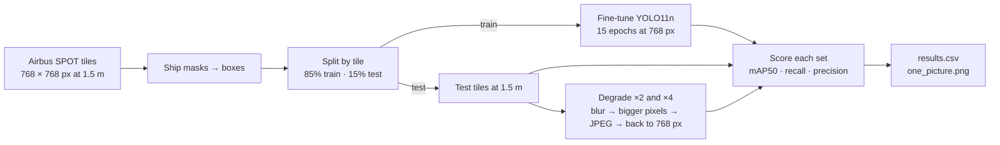
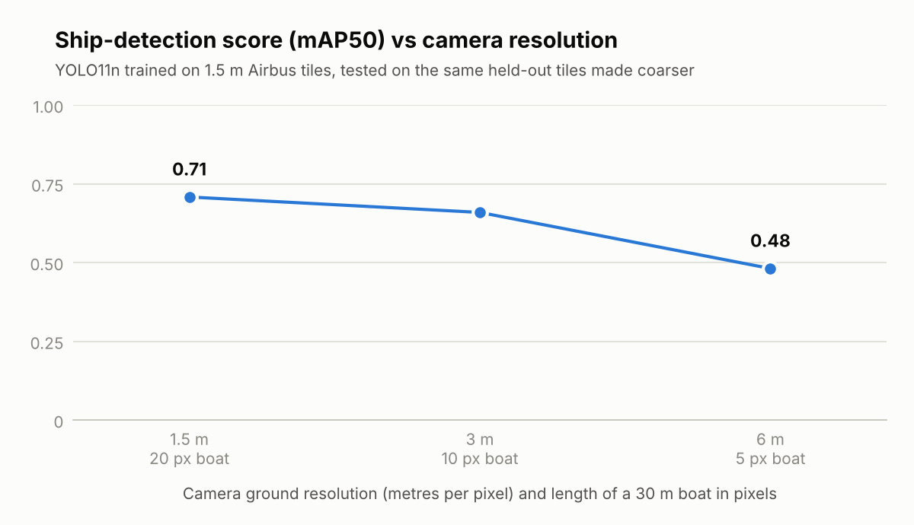

# Ship detection vs. camera resolution

Does a coarser satellite camera hide small ships?

A small YOLO11n detector is trained on Airbus SPOT tiles at 1.5 m ground resolution, then scored on the same held-out tiles degraded to look like a 3 m and a 6 m camera. Only the camera changes between the three scores: same detector, same tiles, same ships.



## Why it matters

Small satellites carry small optics, so they see the sea far less sharply than large imaging satellites. A 30 m fishing boat spans about 20 pixels at 1.5 m per pixel, but only 5 at 6 m. This experiment measures how much detection quality is lost as the ground sampling distance grows, with everything else held fixed.

## Method

| Step | What happens |
|---|---|
| Labels | Airbus stores each ship as a run-length mask, counted down each column. Each mask becomes the smallest upright box around the ship. |
| Data | 4,000 tiles with ships plus 1,000 of empty sea, so the model also learns "no ship". 15% of tiles are held out for testing, split by tile. |
| Training | YOLO11n, pre-trained on COCO, fine-tuned for 15 epochs at 768 px. |
| Coarser cameras | Each test tile is blurred (Gaussian, σ = 0.5k px, a stand-in for the optics), block-averaged by a factor k, JPEG-compressed at quality 85 and resized back to 768 px. k = 2 gives a 3 m camera, k = 4 a 6 m camera. Boxes are stored as fractions of the tile, so labels are unchanged. |
| Scoring | mAP50 at each resolution. Recall and precision are reported at each run's best-F1 confidence, so rows are compared on mAP50. |

## Results

First full run on Kaggle, on one Tesla T4: 4,250 training tiles and 750 test tiles holding 1,211 ships. Training took 12 minutes, and the whole notebook ran in about 16.

| Camera | mAP50 | Recall | Precision |
|---|---|---|---|
| 1.5 m (the training resolution) | 0.708 | 0.623 | 0.751 |
| 3 m | 0.659 | 0.582 | 0.737 |
| 6 m | 0.481 | 0.419 | 0.655 |
| 12 m (cell 11) | 0.204 | 0.181 | 0.670 |

<picture>
  <source media="(prefers-color-scheme: dark)" srcset="results/score_vs_resolution_dark.png">
  
</picture>

- **3 m costs little.** Halving the resolution lowers mAP50 by 7% (0.708 → 0.659).
- **6 m costs a third.** mAP50 falls by 32% at 6 m, and by 71% at 12 m.
- **Misses, not false alarms.** Recall falls faster than precision (at 6 m, 0.623 → 0.419 against 0.751 → 0.655, each at its run's best-F1 threshold), so the coarser camera mostly makes the detector miss ships rather than invent them.
- **Small ships are common.** Of the 7,718 ships in the 5,000 sampled tiles, the median is 37 px long at 1.5 m and one in ten is 11 px or shorter. At 6 m those become about 9 px and under 3 px.

Inference took 4–7 ms per 768 px tile on the T4 during scoring. The notebook also draws one test tile at each resolution (`one_picture.png`); it is not published here, because the competition rules do not allow sharing the Airbus images.

## Run it on Kaggle

1. Accept the rules of the [Airbus Ship Detection Challenge](https://www.kaggle.com/c/airbus-ship-detection).
2. Create a notebook, then **File → Import Notebook** and import `ship_detection_vs_resolution.ipynb` from this repository.
3. **Add Input → Competitions → Airbus Ship Detection Challenge**.
4. In the settings, choose **GPU T4 x2** and turn **Internet on** (needed to install Ultralytics and download the YOLO11n weights).
5. Run the cells in order. In the first full run, training took 12 minutes on one T4 and the whole notebook about 16.

Outputs are written to `/kaggle/working`: `results.csv`, `one_picture.png` and the training run under `runs/`.

## Test it on fake data (CPU)

```bash
pip install -r tests/requirements.txt
python tests/make_fake_data.py /tmp/fake_input
python tests/run_notebook.py /tmp/fake_input /tmp/nb_work
```

This makes 70 synthetic tiles in the Airbus layout and runs every cell end to end with small settings, in about 5–10 minutes on a laptop CPU. It checks that the code runs; the scores it prints mean nothing.

## Limitations

1. Airbus tiles are crops of larger scenes and some overlap, so a test tile can share ships with a training tile: the scores run high.
2. The blur and compression settings are assumptions, not a measured camera.
3. One training run with one seed, so there are no error bars yet.
4. Timings come from a data-centre GPU (T4), not an embedded processor.
5. Upright boxes fit long, thin, rotated ships loosely.

## Next steps

- Recall by ship length, to confirm that the ships lost at coarser resolution are the small ones.
- Retrain on degraded tiles and measure how much of the score comes back.
- Rotated (oriented) boxes for long, thin ships.
- Accuracy and speed on an embedded GPU, including INT8.

## Data

[Airbus Ship Detection Challenge](https://www.kaggle.com/c/airbus-ship-detection) on Kaggle. No data is included in this repository; using it requires accepting the competition rules.

## Files

```
ship_detection_vs_resolution.ipynb   the experiment, cell by cell
requirements.txt                     libraries, for running outside Kaggle
results/results.csv                  scores from the first full run (written by cell 9)
results/score_vs_resolution*.png     the chart above, light and dark
plot_results.py                      draws the chart from results/results.csv
tests/make_fake_data.py              a tiny fake dataset in the Airbus layout
tests/run_notebook.py                runs the notebook end to end on it
```
